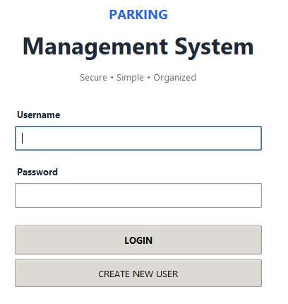
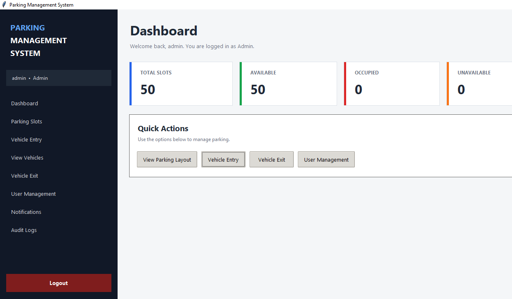
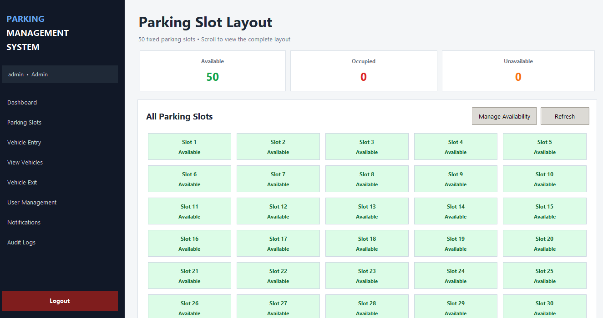

# Parking Management System

A Python-based desktop application developed as a college project with a focus on **Total Quality Management (TQM)**. The application provides a graphical interface for managing parking spaces and related parking operations.

## 📸 Screenshots

### Login Screen


### Dashboard


### Parking Slots


## 🎯 Project Objectives

- Develop a desktop application for parking management.
- Provide a graphical user interface for parking-related operations.
- Organize parking slot information and availability.
- Apply software quality principles to improve reliability, usability, and security.
- Support better monitoring and management of parking spaces.

## 🛠️ Technologies Used

- **Python** — Application development
- **Tkinter** — Graphical user interface
- **SQLite** — Database management
- **Git and GitHub** — Version control and project hosting
- **PyInstaller** — Packaging the application for Windows

## ✨ Main Modules

The project is designed around the following modules:

- **Login System:** User login interface.
- **Dashboard:** Main interface for accessing application functions.
- **Parking Slot Management:** View and manage parking slot availability and status.
- **Vehicle Management:** Support for parking-related vehicle operations.
- **Database:** Store application data using SQLite.
- **Quality and Security:** Apply input validation and appropriate account-protection and activity-logging measures where implemented.

*Note: The availability of individual functions depends on the current implementation of the application.*

## 📂 Project Structure

```text
Parking-Management-System/
│
├── main.py
├── database.py
├── requirements.txt
├── README.md
├── .gitignore
└── screenshots/
    ├── login.png
    ├── dashboard.png
    └── parking-slots.png
```

## 🚀 How to Run the Application

### Option 1: Run the packaged Windows application

1. Download `ParkingManagementSystem.zip` from the provided project distribution.
2. Extract the ZIP file.
3. Open the extracted folder.
4. Double-click `ParkingManagementSystem.exe`.

Keep the database file and other packaged application files in their expected locations.

### Option 2: Run from the source code

**Requirements:** Python installed on your computer.

1. Clone the repository:

   ```bash
   git clone https://github.com/Kosto17/Parking-Management-System.git
   ```

2. Open the project folder:

   ```bash
   cd Parking-Management-System
   ```

3. Run the application:

   ```bash
   python main.py
   ```

If the application requires any additional packages, install them using the provided requirements file:

```bash
pip install -r requirements.txt
```

## 📊 Total Quality Management (TQM) Focus

This project is developed as part of an academic study of software quality.

The main quality considerations include:

- **Security:** Protecting access to the application.      
- **Reliability:** Keeping parking information organized.
- **Usability:** Providing a clear and understandable interface.
- **Validation:** Reducing invalid input.
- **Maintainability:** Keeping the application code organized.
- **Testing:** Checking application functions and correcting errors.

## 🔮 Future Improvements

- Improve the user interface and user experience.
- Expand parking activity reports.
- Strengthen security and account-management features.
- Improve automated testing and error handling.
- Add further reporting and monitoring capabilities.

## 🎓 Academic Project

**Project Name:** Parking Management System  
**Domain:** Computer Science and Engineering  
**Subject Focus:** Total Quality Management (TQM)

---

Developed as an academic project to explore parking management and software quality principles.
